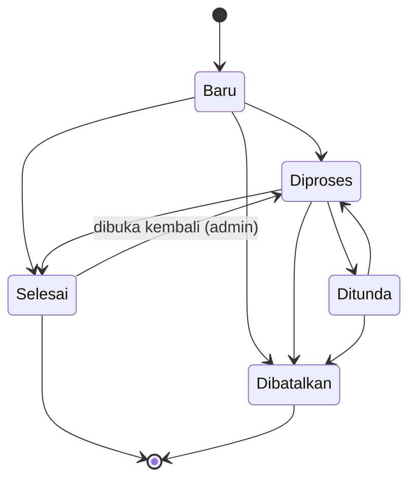

# PRD — Aplikasi Pelaporan Kerusakan Fasilitas Kantor

| | |
|---|---|
| **Nama sementara** | SiLapor (Sistem Pelaporan Fasilitas) |
| **Versi** | 0.1 (Draft untuk review) |
| **Tanggal** | 13 Oktober 2026 |
| **Platform** | Web (responsif, dapat dibuka dari HP maupun komputer) |
| **Target pengguna** | ± 30 pegawai kantor + 1–2 staf IT |

---

## 1. Ringkasan

SiLapor adalah aplikasi web untuk melaporkan dan memantau penanganan kerusakan fasilitas kantor (WiFi, komputer, printer, dll.). Pelapor mendapat **kode unik** per laporan (contoh `#WF001`, `#KOM001`) dan dapat memantau progres lewat **log progres** yang tidak dapat dihapus. Staf IT mengelola status laporan, memberi keterangan progres, dan menganalisis kendala yang berulang lewat halaman statistik.

Pelaporan sengaja dibuat **tanpa hambatan**: siapa pun di kantor dapat melapor meski belum registrasi atau login.

## 2. Latar Belakang dan Masalah

Tanpa sistem terpusat, laporan kerusakan biasanya masuk lewat chat atau lisan sehingga:

- laporan mudah terlewat atau tenggelam di grup chat;
- pelapor tidak tahu laporannya sudah ditangani atau belum;
- staf IT tidak punya data untuk melihat kendala yang sering berulang (misalnya WiFi di lantai 2 terus bermasalah);
- tidak ada riwayat penanganan yang bisa dirujuk kembali.

## 3. Tujuan dan Indikator Keberhasilan

| Tujuan | Indikator (dievaluasi 1–2 bulan setelah rilis) |
|---|---|
| Semua laporan terpusat di satu tempat | ≥ 90% laporan kerusakan masuk lewat aplikasi |
| Pelapor tahu status laporannya | Setiap laporan punya kode unik dan log progres yang terisi |
| Respons staf IT lebih cepat dan terukur | Waktu rata-rata dari laporan masuk sampai status pertama berubah dapat dilihat di statistik |
| Kendala berulang dapat dianalisis | Admin dapat melihat daftar kombinasi kategori + lokasi yang paling sering dilaporkan |
| Adopsi pegawai | ≥ 80% dari 30 pegawai memiliki akun atau pernah membuat laporan |

## 4. Ruang Lingkup

### Termasuk (MVP)
- Registrasi, login, logout, dan mode guest
- Pembuatan laporan oleh guest, user, dan admin
- Kode unik laporan berbasis kategori
- Status laporan dan log progres (append-only)
- Pembatalan laporan oleh user, tercatat di log
- Dashboard admin (highlight laporan terbaru, laporan aktif)
- Halaman statistik berdasarkan jenis kendala
- Manajemen kategori dan pengguna oleh admin

### Tidak termasuk (di luar MVP)
- Edit isi laporan setelah dikirim (jika salah, user membatalkan lalu membuat laporan baru)
- Komentar atau chat dua arah antara pelapor dan staf IT
- Notifikasi email/WhatsApp/push (dipertimbangkan di fase berikutnya)
- Manajemen aset, stok sparepart, dan SLA formal
- Aplikasi mobile native
- Integrasi dengan sistem eksternal (SSO, HRIS, dll.)

## 5. Peran Pengguna dan Hak Akses

| Peran | Deskripsi |
|---|---|
| **Guest** | Pengunjung tanpa login. Dapat melihat laporan dan tetap dapat membuat laporan. |
| **User** | Pegawai yang sudah registrasi dan login. Dapat membuat laporan, memantau laporan miliknya, dan membatalkannya. |
| **Admin (Staf IT)** | Pengelola laporan. Mengubah status, menulis progres, melihat dashboard dan statistik, mengelola kategori dan pengguna. |

### Matriks hak akses

| Fitur | Guest | User | Admin |
|---|:---:|:---:|:---:|
| Melihat daftar dan detail laporan | ✅ (identitas pelapor disamarkan) | ✅ | ✅ |
| Melihat log progres | ✅ | ✅ | ✅ |
| Membuat laporan | ✅ (wajib isi nama & kontak) | ✅ (data diri terisi otomatis) | ✅ |
| Halaman "Laporan Saya" | ❌ | ✅ | — |
| Membatalkan laporan | ❌ (lihat Pertanyaan Terbuka #1) | ✅ (laporan milik sendiri) | ✅ (wajib beri alasan) |
| Mengubah status laporan | ❌ | ❌ | ✅ |
| Menambah keterangan progres | ❌ | ❌ | ✅ |
| Dashboard admin | ❌ | ❌ | ✅ |
| Halaman statistik | ❌ | ❌ | ✅ |
| Kelola kategori | ❌ | ❌ | ✅ |
| Kelola pengguna | ❌ | ❌ | ✅ |

> Hak akses **harus divalidasi di sisi server**, bukan hanya disembunyikan di tampilan.

## 6. Asumsi dan Keputusan Desain

Beberapa poin pada kebutuhan awal perlu ditafsirkan. Berikut keputusan sementara yang dipakai dalam PRD ini (silakan dikoreksi):

1. **Guest dapat melapor dan melihat laporan.** Kebutuhan awal menyebut guest tetap bisa melapor, sekaligus "hanya dapat melihat laporan". PRD ini menafsirkannya sebagai: guest boleh membuat laporan dan melihat daftar/detail laporan, tetapi tidak dapat membatalkan, mengubah, atau mengelola laporan.
2. **Guest wajib mengisi nama dan kontak** (nomor HP atau email) agar staf IT bisa menghubungi pelapor.
3. **Identitas pelapor disamarkan untuk guest** (misalnya "Budi S." atau "Pelapor Tamu"), sedangkan nama lengkap dan kontak hanya terlihat oleh admin dan pemilik laporan.
4. **Admin = Staf IT.** Akun admin dibuat/ditetapkan secara manual, tidak bisa lewat registrasi publik.
5. **Registrasi terbuka**, akun langsung aktif; admin dapat menonaktifkan akun.
6. **Laporan "Selesai" disembunyikan dari tampilan default dashboard admin**, tetapi tetap tersimpan, tetap dihitung di statistik, dan tetap bisa dilihat lewat filter/arsip. Laporan "Dibatalkan" diperlakukan sama karena tidak memerlukan tindakan.
7. **Cakupan fasilitas awal adalah fasilitas IT** (sesuai peran admin = staf IT). Kategori dapat ditambah admin sehingga bisa diperluas ke fasilitas umum.

## 7. Alur Utama

### 7.1 Status laporan

| Status | Arti |
|---|---|
| **Baru** | Laporan masuk, belum ditangani |
| **Diproses** | Sedang ditangani staf IT |
| **Ditunda** | Menunggu sesuatu (sparepart, vendor, jadwal) |
| **Selesai** | Masalah teratasi |
| **Dibatalkan** | Dibatalkan oleh pelapor atau admin (mis. laporan duplikat) |

Aturan:
- Setiap perubahan status menghasilkan satu entri di log progres.
- Status **Dibatalkan** bersifat final.
- Status **Selesai** hanya dapat dibuka kembali oleh admin dengan catatan wajib.

### 7.2 Alur pelapor

1. Buka aplikasi → klik **Buat Laporan** (tanpa login) atau login terlebih dahulu.
2. Isi form (kategori, lokasi, deskripsi, dst.) → kirim.
3. Sistem menampilkan **kode laporan** (mis. `#WF001`) dan tautan ke halaman detail.
4. Pelapor memantau status dan log progres di halaman detail (user juga lewat **Laporan Saya**).
5. Jika masalah sudah tidak relevan, user dapat **membatalkan** laporan dengan alasan.

### 7.3 Alur admin

1. Login → masuk **Dashboard** → melihat highlight laporan terbaru.
2. Buka detail laporan → ubah status dan/atau tulis keterangan progres.
3. Tandai **Selesai** setelah masalah teratasi → laporan hilang dari tampilan aktif.
4. Secara berkala buka **Statistik** untuk melihat kendala yang berulang.

## 8. Kebutuhan Fungsional

Prioritas: **[M]** Must (wajib MVP), **[S]** Should (sangat disarankan), **[C]** Could (opsional).

### 8.1 Autentikasi dan Akun

| ID | Kebutuhan | Prioritas |
|---|---|:---:|
| AUTH-01 | Registrasi dengan nama, email, password, dan unit/divisi | M |
| AUTH-02 | Login dengan email + password, serta logout | M |
| AUTH-03 | Email harus unik; password minimal 8 karakter dan disimpan sebagai hash (bcrypt/argon2) | M |
| AUTH-04 | Akses guest tanpa login ke fitur lihat laporan dan buat laporan | M |
| AUTH-05 | Pembatasan percobaan login gagal (rate limiting) | M |
| AUTH-06 | Reset password oleh admin (email reset mandiri dipertimbangkan di fase berikutnya) | S |
| AUTH-07 | Pembatasan domain email pada registrasi (mis. hanya @namakantor.com), bila diminta | C |
| AUTH-08 | User dapat mengubah profil dan password sendiri | S |

### 8.2 Pembuatan Laporan

| ID | Kebutuhan | Prioritas |
|---|---|:---:|
| RPT-01 | Field wajib: **kategori**, **lokasi** (ruangan/lantai), **deskripsi** kendala | M |
| RPT-02 | Field judul singkat (otomatis disarankan dari kategori bila kosong) | S |
| RPT-03 | Field **tingkat urgensi** (Rendah / Sedang / Tinggi); admin dapat mengubahnya | S |
| RPT-04 | **Sub-jenis kendala** opsional per kategori (mis. WiFi → Lambat, Putus-putus, Tidak bisa terhubung) untuk memperkaya analisis | S |
| RPT-05 | Unggah foto pendukung: maks. 3 file, tiap file ≤ 2 MB, format JPG/PNG/WebP | S |
| RPT-06 | Untuk guest: wajib isi nama dan kontak; untuk user: data diri diambil otomatis dari akun | M |
| RPT-07 | Perlindungan spam untuk guest: CAPTCHA sederhana/honeypot dan batas jumlah laporan per IP per jam | M |
| RPT-08 | Saat mengisi form, tampilkan petunjuk jika sudah ada laporan **aktif** dengan kategori + lokasi yang sama (untuk mengurangi laporan duplikat) | C |
| RPT-09 | Waktu laporan tercatat otomatis (disimpan UTC, ditampilkan WIB) | M |

### 8.3 Kode Unik Laporan

| ID | Kebutuhan | Prioritas |
|---|---|:---:|
| KODE-01 | Format kode: `#` + **prefix kategori** + **nomor urut 3 digit**, contoh `#WF001`, `#WF002`, `#KOM001` | M |
| KODE-02 | Nomor urut dihitung **per kategori**, dimulai dari 001; setelah 999 otomatis menjadi 4 digit (`#WF1000`) | M |
| KODE-03 | Kode **unik** dan **tidak pernah dipakai ulang**, termasuk untuk laporan yang dibatalkan | M |
| KODE-04 | Kode dibuat di server secara atomik (transaksi/lock) agar tidak terjadi duplikat saat dua laporan masuk bersamaan | M |
| KODE-05 | Prefix kategori: 2–4 huruf kapital, unik, dan tidak dapat diubah setelah dipakai oleh laporan | M |
| KODE-06 | Pencarian laporan menggunakan kode (dengan atau tanpa tanda `#`, tidak sensitif huruf besar/kecil) | M |

**Kategori awal (dapat diubah admin):**

| Kategori | Prefix |
|---|---|
| Jaringan WiFi | `WF` |
| Komputer / Laptop | `KOM` |
| Printer / Scanner | `PRN` |
| Jaringan Kabel / Internet | `NET` |
| Software / Aplikasi | `SW` |
| Akun & Akses | `AKN` |
| Perangkat Presentasi (proyektor/TV) | `PRS` |
| Lainnya | `LNN` |

### 8.4 Status dan Log Progres

| ID | Kebutuhan | Prioritas |
|---|---|:---:|
| LOG-01 | Setiap laporan memiliki **log progres** berbentuk timeline kronologis | M |
| LOG-02 | Entri log dibuat otomatis untuk: laporan dibuat, perubahan status, catatan progres, perubahan urgensi, pembatalan, dan pembukaan kembali | M |
| LOG-03 | Setiap entri memuat: waktu, pelaku (nama + peran), jenis kejadian, status sebelum → sesudah, dan keterangan | M |
| LOG-04 | Log bersifat **append-only**: tidak ada fitur edit atau hapus entri, bahkan untuk admin | M |
| LOG-05 | Admin dapat menambahkan **keterangan progres** tanpa mengubah status (mis. "Menunggu teknisi vendor, estimasi Kamis") | M |
| LOG-06 | Perubahan ke status **Ditunda** dan **Dibatalkan** oleh admin mewajibkan keterangan | M |
| LOG-07 | Log dapat dilihat oleh guest, user, dan admin pada halaman detail laporan | M |

### 8.5 Pembatalan Laporan

| ID | Kebutuhan | Prioritas |
|---|---|:---:|
| CNL-01 | User dapat membatalkan **laporan miliknya sendiri** selama status **Baru, Diproses, atau Ditunda** | M |
| CNL-02 | Pembatalan **wajib disertai alasan** (teks singkat) dan dikonfirmasi lewat dialog | M |
| CNL-03 | Laporan yang dibatalkan **tidak dihapus**: status berubah menjadi *Dibatalkan*, kode tetap ada, dan kejadian **tercatat di log progres** (siapa, kapan, alasan) | M |
| CNL-04 | Laporan berstatus *Selesai* atau *Dibatalkan* tidak dapat dibatalkan lagi | M |
| CNL-05 | Admin dapat membatalkan laporan (mis. duplikat/tidak valid) dengan alasan wajib; log mencatat bahwa pelakunya admin | M |

### 8.6 Dashboard Admin

| ID | Kebutuhan | Prioritas |
|---|---|:---:|
| DSH-01 | **Highlight laporan terbaru**: 5–10 laporan terbaru yang masih berstatus *Baru*, ditandai badge "BARU", diurutkan dari yang paling baru; urgensi Tinggi diberi penanda khusus | M |
| DSH-02 | Kartu ringkasan jumlah laporan aktif per status (Baru, Diproses, Ditunda) | M |
| DSH-03 | Tabel **laporan aktif** dengan pencarian (kode/judul/lokasi), filter (status, kategori, urgensi), pengurutan, dan paginasi | M |
| DSH-04 | Laporan **Selesai disembunyikan** dari dashboard dan tabel aktif secara default (laporan Dibatalkan juga, lihat Asumsi #6) | M |
| DSH-05 | Laporan Selesai/Dibatalkan tetap dapat diakses lewat toggle "Tampilkan selesai" atau halaman **Arsip** | M |
| DSH-06 | Penanda visual untuk laporan aktif yang belum ada pembaruan selama N hari (default 3 hari; dapat diatur) | C |

**Kriteria penerimaan DSH-04:** setelah admin mengubah status menjadi *Selesai*, laporan tidak lagi muncul di dashboard maupun tabel laporan aktif, tetapi tetap muncul di statistik, di halaman Arsip, dan di daftar laporan yang dilihat user/guest.

### 8.7 Halaman Statistik (Admin)

Tujuan utama: **mengidentifikasi kendala yang berulang**.

| ID | Kebutuhan | Prioritas |
|---|---|:---:|
| STA-01 | Filter periode: 7 hari, 30 hari, 90 hari, tahun ini, dan rentang kustom | M |
| STA-02 | Ringkasan: total laporan, aktif, selesai, dibatalkan, dan rata-rata waktu penyelesaian | M |
| STA-03 | Grafik **jumlah laporan per jenis kendala (kategori)** beserta persentasenya | M |
| STA-04 | Grafik **tren per bulan** per kategori untuk melihat apakah kendala meningkat atau menurun | S |
| STA-05 | Tabel **Kendala Berulang**: kombinasi kategori (+ sub-jenis) dan lokasi, diurutkan dari yang paling sering muncul | M |
| STA-06 | Penanda "Berulang" otomatis bila suatu kombinasi muncul ≥ **3 kali dalam 30 hari** (ambang dapat diatur admin) | M |
| STA-07 | Setiap baris pada tabel kendala berulang dapat diklik untuk melihat daftar laporan terkait (termasuk yang sudah selesai) | S |
| STA-08 | Statistik **mencakup laporan Selesai**; laporan Dibatalkan dikecualikan secara default (dapat diikutkan lewat opsi) | M |
| STA-09 | Rata-rata waktu penyelesaian per kategori | S |
| STA-10 | Ekspor data statistik ke CSV | C |

### 8.8 Manajemen Kategori dan Pengguna (Admin)

| ID | Kebutuhan | Prioritas |
|---|---|:---:|
| ADM-01 | Tambah, ubah nama, dan nonaktifkan kategori; kategori yang sudah dipakai tidak boleh dihapus permanen | M |
| ADM-02 | Kelola sub-jenis kendala per kategori | S |
| ADM-03 | Lihat daftar pengguna; aktifkan/nonaktifkan akun | M |
| ADM-04 | Ubah peran pengguna (User ↔ Admin) | M |
| ADM-05 | Reset password pengguna | S |

### 8.9 Tampilan Publik (Guest dan User)

| ID | Kebutuhan | Prioritas |
|---|---|:---:|
| PUB-01 | Daftar laporan dengan pencarian (kode/judul), filter status dan kategori, urut terbaru, dan paginasi | M |
| PUB-02 | Halaman detail laporan: kode, kategori, lokasi, deskripsi, foto, status saat ini, dan log progres | M |
| PUB-03 | Setelah mengirim laporan, tampilkan kode laporan dengan jelas dan tombol salin | M |
| PUB-04 | User memiliki halaman **Laporan Saya** (semua status) dengan tombol batalkan bila memenuhi syarat | M |

## 9. Kebutuhan Non-Fungsional

| Aspek | Kebutuhan |
|---|---|
| **Responsif** | Form laporan dan halaman detail nyaman dipakai di layar HP (pegawai sering melapor langsung dari lokasi kerusakan) |
| **Performa** | Halaman utama termuat < 2 detik untuk ± 30 pengguna; beban rendah sehingga infrastruktur sederhana sudah cukup |
| **Keamanan** | HTTPS; password di-hash; proteksi CSRF dan XSS; validasi input di server; RBAC di server; rate limiting login dan pembuatan laporan guest; validasi file unggahan (tipe, ukuran, nama file di-generate ulang) |
| **Privasi** | Nama lengkap dan kontak pelapor hanya terlihat oleh admin dan pemilik laporan; guest hanya melihat identitas samaran |
| **Integritas data** | Log progres append-only; laporan tidak dihapus permanen; kode laporan unik dan tidak dipakai ulang |
| **Backup** | Backup harian database dan folder unggahan, disimpan minimal 14 hari |
| **Zona waktu** | Disimpan dalam UTC, ditampilkan dalam WIB (Asia/Jakarta) |
| **Bahasa** | Antarmuka Bahasa Indonesia |
| **Kompatibilitas** | Versi terbaru Chrome, Edge, Firefox, dan Safari |
| **Aksesibilitas** | Kontras warna memadai, form berlabel jelas, dapat dioperasikan dengan keyboard |

## 10. Struktur Halaman

| Area | Halaman | Akses |
|---|---|---|
| Publik | Beranda (ringkasan + tombol Buat Laporan) | Semua |
| | `/laporan` — daftar laporan | Semua |
| | `/laporan/{kode}` — detail + log progres | Semua |
| | `/lapor` — form buat laporan | Semua |
| | `/login`, `/register` | Guest |
| User | `/laporan-saya` — laporan milik sendiri | User |
| | `/profil` — ubah profil dan password | User, Admin |
| Admin | `/admin` — dashboard | Admin |
| | `/admin/laporan` — kelola laporan aktif + arsip | Admin |
| | `/admin/statistik` — statistik dan kendala berulang | Admin |
| | `/admin/kategori` — kelola kategori dan sub-jenis | Admin |
| | `/admin/pengguna` — kelola pengguna | Admin |

Halaman detail laporan (`/laporan/{kode}`) menyesuaikan tampilan sesuai peran: user pemilik melihat tombol **Batalkan**, admin melihat panel **Ubah Status** dan **Tambah Progres**.

## 11. Model Data (Konseptual)

**users**

| Field | Keterangan |
|---|---|
| id | Primary key |
| name, email (unik), password_hash | Data akun |
| unit | Unit/divisi |
| role | `user` / `admin` |
| is_active | Boolean |
| created_at | Timestamp |

**categories**

| Field | Keterangan |
|---|---|
| id | Primary key |
| name | Nama kategori |
| prefix | Unik, 2–4 huruf kapital |
| last_seq | Penghitung nomor urut terakhir |
| is_active | Boolean |

**issue_types** (sub-jenis kendala, opsional)

| Field | Keterangan |
|---|---|
| id, category_id, name, is_active | Sub-jenis kendala per kategori |

**reports**

| Field | Keterangan |
|---|---|
| id | Primary key |
| code | Unik, mis. `WF001` (tanda `#` hanya untuk tampilan) |
| category_id, issue_type_id (nullable) | Jenis kendala |
| title, description, location | Isi laporan |
| urgency | `rendah` / `sedang` / `tinggi` |
| status | `baru` / `diproses` / `ditunda` / `selesai` / `dibatalkan` |
| reporter_user_id (nullable) | Terisi bila pelapor adalah user |
| guest_name, guest_contact (nullable) | Terisi bila pelapor adalah guest |
| created_at, updated_at | Timestamp |
| completed_at, cancelled_at (nullable) | Untuk statistik waktu penyelesaian |

**report_logs** (append-only)

| Field | Keterangan |
|---|---|
| id, report_id | Relasi ke laporan |
| actor_type | `guest` / `user` / `admin` / `system` |
| actor_id (nullable), actor_name | Pelaku (nama disimpan agar log tetap utuh walau akun berubah) |
| event_type | `dibuat` / `status_berubah` / `catatan` / `urgensi_berubah` / `dibatalkan` / `dibuka_kembali` |
| from_status, to_status (nullable) | Perubahan status |
| note | Keterangan / alasan |
| created_at | Timestamp |

**attachments**

| Field | Keterangan |
|---|---|
| id, report_id, file_path, mime_type, size_bytes, created_at | Foto pendukung |

## 12. Rekomendasi Teknologi (Opsional, dapat disesuaikan)

Karena skalanya kecil (± 30 pengguna), pilih teknologi yang sederhana dan mudah dirawat:

- **Backend + frontend:** satu framework full-stack (mis. Laravel, atau Next.js/Node.js)
- **Database:** PostgreSQL atau MySQL (SQLite masih memadai untuk skala ini)
- **Autentikasi:** session berbasis cookie `HttpOnly` + CSRF token
- **Penyimpanan foto:** disk server lokal (atau object storage bila tersedia)
- **Hosting:** server internal kantor atau VPS kecil dengan HTTPS dan backup terjadwal

Pilihan akhir mengikuti kemampuan tim dan infrastruktur yang sudah ada.

## 13. Rencana Rilis

| Fase | Isi |
|---|---|
| **Fase 1 — Fondasi** | Setup proyek, database, registrasi/login/logout, peran (guest/user/admin), manajemen kategori |
| **Fase 2 — Inti pelaporan** | Form laporan (guest + user), kode unik, daftar dan detail laporan, log progres, ubah status dan progres oleh admin, pembatalan oleh user |
| **Fase 3 — Dashboard dan statistik** | Dashboard admin (highlight laporan terbaru, laporan aktif, sembunyikan selesai/arsip), halaman statistik dan kendala berulang |
| **Fase 4 — Penyempurnaan** | Unggah foto, sub-jenis kendala, proteksi spam, UAT dengan beberapa pegawai, backup, dan deployment |
| **Fase berikutnya** | Notifikasi email/WhatsApp, reset password via email, komentar pelapor, ekspor CSV |

## 14. Risiko dan Mitigasi

| Risiko | Mitigasi |
|---|---|
| Spam atau laporan iseng dari guest | CAPTCHA/honeypot, batas laporan per IP, admin dapat membatalkan laporan tidak valid |
| Laporan duplikat untuk masalah yang sama | Petunjuk laporan serupa saat mengisi form (RPT-08); admin membatalkan duplikat dengan alasan |
| Pegawai tetap melapor lewat chat | Sosialisasi, dan staf IT mengarahkan setiap laporan chat ke aplikasi |
| Ketergantungan pada satu staf IT | Dukungan lebih dari satu akun admin; log progres membantu serah terima |
| Data pribadi pelapor terlihat publik | Identitas disamarkan untuk guest; kontak hanya terlihat admin dan pemilik |
| Kehilangan data | Backup harian dan uji pemulihan berkala |

## 15. Pertanyaan Terbuka

1. **Pembatalan oleh guest:** apakah guest boleh membatalkan laporannya sendiri? Jika ya, opsi sederhananya adalah *token pembatalan* yang ditampilkan sekali setelah laporan dikirim. Defaultnya: tidak boleh; guest meminta admin membatalkan.
2. **Cakupan fasilitas:** hanya fasilitas IT, atau juga fasilitas umum (AC, listrik, furnitur, toilet)? Jika juga, siapa yang menangani dan apakah perlu peran admin tambahan?
3. **Registrasi:** apakah cukup terbuka, atau perlu pembatasan domain email / persetujuan admin?
4. **Jumlah admin:** apakah staf IT hanya satu orang atau lebih? (Memengaruhi kebutuhan penugasan laporan ke staf tertentu.)
5. **Visibilitas laporan untuk guest:** apakah semua laporan boleh dilihat guest, atau hanya laporan tertentu (mis. yang bukan berisi informasi sensitif)?
6. **Notifikasi:** apakah pelapor perlu diberi tahu otomatis (email/WhatsApp) saat status berubah, atau cukup memantau lewat aplikasi?
7. **Kategori awal dan prefix:** apakah daftar kategori di bagian 8.3 sudah sesuai kebutuhan kantor?
8. **Penugasan laporan:** apakah perlu fitur *assign* ke staf IT tertentu? (Saat ini tidak termasuk MVP.)
