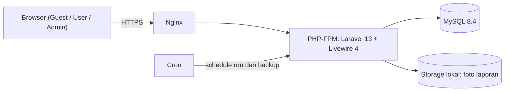

# Dokumentasi Tech Stack — SiLapor

| | |
|---|---|
| **Aplikasi** | SiLapor — Aplikasi Pelaporan Kerusakan Fasilitas Kantor |
| **Dokumen terkait** | [`prd.md`](./prd.md) |
| **Versi dokumen** | 0.1 (Draft) |
| **Tanggal** | 13 Oktober 2026 |
| **Framework utama** | Laravel 13 |

> **Catatan versi.** Dokumen ini mencatat *versi mayor* yang dipilih dan alasannya. Versi persis (patch) yang terpasang selalu mengacu pada `composer.lock` dan `package-lock.json`, bukan dokumen ini. Dukungan versi diverifikasi pada 13 Oktober 2026; periksa ulang sebelum upgrade besar.

---

## 1. Ringkasan Stack

| Lapisan | Teknologi | Versi | Peran |
|---|---|---|---|
| Bahasa | PHP | **8.5** (cadangan: 8.4; minimum Laravel 13: 8.3) | Runtime backend |
| Framework | Laravel | **13.x** (`^13.0`) | Backend, routing, ORM, auth, validasi |
| UI interaktif | Livewire | **4.x** | Komponen reaktif tanpa menulis API/SPA terpisah |
| JS ringan | Alpine.js | Bawaan Livewire | Interaksi kecil (dropdown, modal, toggle) |
| Styling | Tailwind CSS | **4.x** | Utility CSS |
| Komponen UI | Flux UI (edisi gratis) | **2.x** | Tombol, input, modal, dropdown, dll. |
| Autentikasi | Laravel Fortify (via starter kit) | Mengikuti starter kit | Login, registrasi, logout |
| Database | MySQL | **8.4 LTS** (alternatif: MariaDB LTS / PostgreSQL) | Penyimpanan data |
| Grafik | Chart.js | Stabil terbaru saat instalasi | Grafik halaman statistik |
| Build frontend | Vite + Node.js | Vite bawaan skeleton; Node.js LTS (disarankan ≥ 22.12) | Bundling aset |
| Pengujian | Pest | **4.x** | Unit dan feature test |
| Kualitas kode | Laravel Pint, Larastan (PHPStan) | Pint 1.x, Larastan 3.x | Format dan analisis statis |
| Web server | Nginx + PHP-FPM | Paket OS | Melayani aplikasi |
| OS server | Ubuntu Server LTS | LTS terbaru | Hosting |
| Version control | Git | — | Riwayat kode |

### Arsitektur sederhana



Aplikasi berbentuk **monolit** (satu codebase Laravel). Tidak ada API terpisah, tidak ada SPA terpisah, dan tidak ada layanan tambahan seperti Redis atau message broker. Hal ini disengaja karena skalanya hanya ± 30 pengguna.

## 2. Prinsip Pemilihan

1. **Sederhana dulu.** Satu framework, satu database, satu paradigma UI. Mudah dirawat oleh satu atau dua orang.
2. **Resmi dan terawat.** Mengutamakan paket first-party Laravel/Livewire yang masih aktif dikembangkan.
3. **Tanpa biaya lisensi.** Hanya komponen gratis/open source; komponen berbayar (mis. Flux Pro) tidak digunakan.
4. **Mudah di-hosting.** Cukup VPS kecil atau server internal kantor.
5. **Sesuai PRD.** Setiap kebutuhan penting di `prd.md` harus punya pendekatan teknis yang jelas (lihat bagian 5).

## 3. Detail per Lapisan

### 3.1 Runtime dan Framework

- **PHP 8.5** dipilih karena masa dukungan paling panjang: dukungan aktif sampai 31 Des 2027 dan dukungan keamanan sampai 31 Des 2029. **PHP 8.4** boleh dipakai bila server belum mendukung 8.5 (dukungan aktif sampai 31 Des 2026, keamanan sampai 31 Des 2028).
- **Laravel 13** dirilis 17 Maret 2026, membutuhkan PHP 8.3–8.5, dengan perbaikan bug sampai Q3 2027 dan perbaikan keamanan sampai Q1 2028. Tidak ada rilis LTS khusus; Laravel merilis versi mayor setiap tahun.
- **Composer 2** untuk manajemen dependensi PHP.
- Proyek dibuat dengan Laravel installer: `laravel new silapor` dan memilih **Livewire starter kit**.

### 3.2 Frontend

- **Livewire 4** menjadi lapisan UI utama untuk seluruh area (publik, user, admin): form laporan, daftar dengan filter dan paginasi, detail laporan, dashboard.
- **Tailwind CSS 4** dan **Flux UI gratis** datang bersama Livewire starter kit resmi. Tabel, kartu ringkasan, dan timeline log dibuat dengan Blade + Tailwind.
- **Chart.js** dipasang lewat npm untuk grafik di halaman statistik, dibungkus komponen Alpine/Livewire. Komponen grafik Flux bersifat Pro (berbayar), sehingga tidak dipakai.
- **Vite** meng-compile CSS dan JS; hasil build (`public/build`) diletakkan di server produksi.
- Desain **mobile-first** karena pelaporan sering dilakukan dari HP (lihat kebutuhan non-fungsional di PRD).

### 3.3 Autentikasi dan Otorisasi

| Aspek | Pendekatan |
|---|---|
| Login, registrasi, logout | Laravel Fortify dari starter kit; kode berada di dalam aplikasi sehingga bebas disesuaikan |
| Field tambahan registrasi | Kolom `unit` (divisi) ditambahkan di `users` dan di action registrasi Fortify |
| Peran | Kolom `role` bertipe PHP **backed enum** (`user`, `admin`) pada tabel `users` |
| Guest | Pengunjung **tidak terautentikasi**; tidak butuh peran di database |
| Aturan akses | **Laravel Policy** (mis. `ReportPolicy::cancel`) dan middleware `role:admin` untuk area `/admin` |
| Pembatasan login | Rate limiter bawaan Fortify/Laravel |
| Fitur dinonaktifkan di MVP | Verifikasi email, 2FA, dan reset password via email (belum ada SMTP). Reset password dilakukan admin sesuai PRD (AUTH-06). Dapat diaktifkan kembali lewat konfigurasi Fortify |

Paket manajemen peran seperti `spatie/laravel-permission` **tidak dipakai** karena hanya ada dua peran tetap.

### 3.4 Database

- **MySQL 8.4 LTS** dipilih karena umum tersedia di VPS maupun hosting di Indonesia. **MariaDB (LTS)** dan **PostgreSQL** juga didukung Laravel dan dapat menggantikannya tanpa mengubah kode aplikasi secara berarti.
- Skema dikelola lewat **Laravel Migration**; data awal (kategori, akun admin pertama) lewat **Seeder**.
- Tabel mengikuti model data di `prd.md` bagian 11: `users`, `categories`, `issue_types`, `reports`, `report_logs`, `attachments`.
- Indeks yang direncanakan:

| Tabel | Indeks | Tujuan |
|---|---|---|
| `reports` | `code` (**unique**) | Kode laporan unik dan pencarian cepat |
| `reports` | `(status, created_at)` | Dashboard dan daftar laporan aktif |
| `reports` | `(category_id, location, created_at)` | Analisis kendala berulang |
| `reports` | `reporter_user_id` | Halaman "Laporan Saya" |
| `report_logs` | `(report_id, created_at)` | Timeline log |
| `categories` | `prefix` (**unique**) | Prefix kode kategori tidak boleh kembar |

- **Zona waktu:** `app.timezone` tetap UTC; konversi ke **WIB (Asia/Jakarta)** dilakukan saat ditampilkan (sesuai PRD). `app.locale` diatur ke `id`.

### 3.5 Penyimpanan File (Foto Laporan)

- Laravel **Filesystem** dengan disk lokal `public` (`storage/app/public`) dan `php artisan storage:link`.
- Validasi unggahan: tipe JPG/PNG/WebP, maksimal 3 file, masing-masing ≤ 2 MB. Nama file di-generate ulang (UUID) dan tidak memakai nama asli.
- Bila server ingin dipindah ke object storage di masa depan, cukup ganti konfigurasi disk.

### 3.6 Queue, Cache, Session, Scheduler

| Komponen | Pilihan MVP | Catatan |
|---|---|---|
| Session | `database` | Tanpa Redis |
| Cache | `database` atau `file` | Beban sangat kecil |
| Queue | `sync` | Belum ada pekerjaan berat. Beralih ke `database` + worker saat notifikasi email/WhatsApp ditambahkan |
| Scheduler | Cron `* * * * * php artisan schedule:run` | Untuk tugas terjadwal seperti backup |
| Email | Belum digunakan (`MAIL_MAILER=log`) | Disiapkan untuk fase berikutnya |

### 3.7 Perlindungan Spam Guest

- **Rate limiting** Laravel (`RateLimiter` / middleware `throttle`) pada pembuatan laporan guest: batas laporan per IP per jam.
- **Honeypot field** sederhana (implementasi sendiri) pada form.
- **Cloudflare Turnstile** sebagai opsi tambahan bila spam tetap terjadi.

### 3.8 Pengujian dan Kualitas Kode

| Alat | Fungsi |
|---|---|
| **Pest 4** | Feature test untuk alur utama (buat laporan, kode unik, batalkan, ubah status, hak akses) dan unit test |
| **Laravel Pint** | Format kode otomatis (standar Laravel) |
| **Larastan** | Analisis statis PHPStan untuk Laravel |
| **Laravel Pail** | Melihat log secara langsung saat pengembangan |
| **Laravel Tinker** | REPL untuk eksperimen cepat |

Perintah harian yang disepakati:

```bash
composer dev      # jalankan server + vite + log (dari skeleton)
composer test     # jalankan test suite
./vendor/bin/pint # rapikan kode
```

### 3.9 Lingkungan Pengembangan

Pilih salah satu sesuai OS developer:

- **Laravel Herd** (macOS/Windows) atau **Laragon** (Windows) untuk setup cepat tanpa Docker
- **Laravel Sail** (Docker) bila ingin lingkungan seragam antar developer

Database lokal: MySQL (disarankan sama dengan produksi) atau SQLite untuk eksperimen cepat.

### 3.10 Deployment dan Operasional

**Target produksi:** VPS kecil atau server internal kantor dengan Ubuntu Server LTS, Nginx, PHP-FPM, MySQL, dan HTTPS (Let's Encrypt).

> Hosting bersama (cPanel) hanya cocok bila menyediakan **PHP ≥ 8.3**, akses **SSH + Composer**, dan document root dapat diarahkan ke folder `public`. Jika tidak, gunakan VPS.

Langkah deploy standar:

```bash
git pull origin main
composer install --no-dev --optimize-autoloader
npm ci && npm run build
php artisan migrate --force
php artisan optimize
```

| Aspek | Ketentuan |
|---|---|
| Konfigurasi produksi | `APP_ENV=production`, `APP_DEBUG=false`, `APP_KEY` unik, file `.env` tidak masuk Git |
| HTTPS | Wajib; redirect HTTP ke HTTPS |
| Backup | Harian: dump database + folder `storage/app/public`; simpan minimal 14 hari (sesuai PRD); uji pemulihan berkala |
| Log | Channel `daily` dengan retensi terbatas; pantau `storage/logs` |
| Pemantauan error | Log Laravel cukup untuk MVP; Sentry (opsional) bila dibutuhkan |

## 4. Konvensi Proyek

| Hal | Konvensi |
|---|---|
| Bahasa kode | **Inggris** untuk nama class, method, tabel, dan kolom (`reports`, `report_logs`) |
| Bahasa antarmuka | **Indonesia**, disimpan di `lang/id` agar teks tidak tersebar di Blade |
| Status dan urgensi | PHP **backed enum**: `ReportStatus`, `ReportUrgency`, `UserRole` |
| Validasi | **Form Request** atau validasi di komponen Livewire; tidak ada validasi hanya di sisi tampilan |
| Akses data | Eloquent/Query Builder (tanpa raw SQL berparameter manual); logika bisnis kompleks di *action/service class* |
| Kode format | Pint; commit hanya jika `composer test` lulus |
| Git | Cabang `main` (stabil) + cabang fitur (`feature/nama-fitur`); pesan commit singkat dan jelas |

Struktur folder utama (tambahan terhadap skeleton Laravel):

```
app/
├── Enums/            # ReportStatus, ReportUrgency, UserRole
├── Livewire/
│   ├── Public/       # daftar & detail laporan, form lapor
│   ├── User/         # laporan saya
│   └── Admin/        # dashboard, kelola laporan, statistik, kategori, pengguna
├── Models/           # User, Category, IssueType, Report, ReportLog, Attachment
├── Policies/         # ReportPolicy, dll.
└── Actions/          # CreateReport, ChangeReportStatus, CancelReport, GenerateReportCode
```

## 5. Pemetaan Kebutuhan PRD ke Teknologi

| Kebutuhan (PRD) | Pendekatan teknis |
|---|---|
| Kode unik `#WF001`, `#KOM001` (KODE-01 s.d. 06) | Kolom `categories.last_seq` dinaikkan di dalam **DB transaction** dengan `lockForUpdate()`; `reports.code` memiliki **unique index**; nomor memakai `str_pad` 3 digit (otomatis melebar jadi 4 digit setelah 999). Tanda `#` hanya ditambahkan saat tampilan |
| Guest dapat melapor dan melihat laporan | Rute publik tanpa middleware `auth`; hak akses tetap dicek di Policy |
| Identitas pelapor disamarkan untuk guest | *Accessor* pada model/komponen yang menyamarkan nama bila pengguna bukan admin atau pemilik |
| Pembatalan tercatat di log (CNL-01 s.d. 05) | Action `CancelReport`: cek Policy → ubah status → buat entri `report_logs` dalam satu transaction |
| Log progres append-only (LOG-04) | Model `ReportLog` tanpa rute edit/hapus; tidak ada method update/delete yang diekspos; pembatasan tambahan di level model (`updating`/`deleting` event melempar exception) |
| Laporan selesai disembunyikan (DSH-04) | *Local scope* `Report::active()` untuk dashboard; statistik dan arsip memakai query tanpa scope tersebut |
| Highlight laporan terbaru (DSH-01) | Query status `baru` urut `created_at desc` dengan limit, urgensi tinggi diberi penanda |
| Statistik per jenis kendala (STA-03) | Query `GROUP BY category_id` pada rentang periode; tampil lewat Chart.js |
| Kendala berulang (STA-05, 06) | `GROUP BY category_id, issue_type_id, location` dengan `HAVING COUNT(*) >= ambang` pada periode 30 hari; ambang disimpan di konfigurasi |
| Batas spam guest (RPT-07) | `throttle` + honeypot (bagian 3.7) |
| Zona waktu WIB (RPT-09) | Simpan UTC, tampilkan dengan Carbon `->timezone('Asia/Jakarta')` |
| Responsif | Tailwind mobile-first |

Contoh pola pembuatan kode laporan yang aman dari duplikasi:

```php
DB::transaction(function () use ($categoryId, $data) {
    $category = Category::whereKey($categoryId)->lockForUpdate()->firstOrFail();
    $category->increment('last_seq');

    $code = $category->prefix . str_pad($category->last_seq, 3, '0', STR_PAD_LEFT);

    return Report::create([...$data, 'category_id' => $category->id, 'code' => $code]);
});
```

## 6. Keamanan (Ringkasan Teknis)

| Risiko | Mitigasi di stack |
|---|---|
| CSRF | Perlindungan CSRF bawaan Laravel (`PreventRequestForgery` pada Laravel 13) |
| XSS | Blade meng-escape output secara default; hindari `{!! !!}` untuk input pengguna |
| SQL injection | Eloquent/Query Builder dengan parameter binding |
| Password | Hashing bawaan Laravel (bcrypt/argon2); minimal 8 karakter |
| Akses tidak sah | Policy + middleware di server, bukan hanya menyembunyikan tombol |
| Unggahan berbahaya | Validasi tipe (MIME) dan ukuran, nama file di-generate ulang, file tidak dapat dieksekusi |
| Brute force dan spam | Rate limiting pada login dan form guest |
| Kebocoran konfigurasi | `.env` di luar Git, `APP_DEBUG=false` di produksi |
| Dependensi rentan | `composer audit` dan `npm audit` dijalankan berkala |

## 7. Kebijakan Dependensi dan Upgrade

- Gunakan *version constraint* mayor (mis. `^13.0`) dan **selalu commit** `composer.lock` serta `package-lock.json`.
- Jadwalkan pembaruan dependensi minor/patch sebulan sekali; jalankan test sebelum rilis. Patch keamanan diterapkan segera.
- Pantau tanggal akhir dukungan: **Laravel 13** (keamanan sampai Q1 2028) dan **PHP 8.5** (keamanan sampai 31 Des 2029). Evaluasi upgrade ke Laravel mayor berikutnya setelah dirilis, selama masih dalam masa dukungan.
- Tambah paket pihak ketiga hanya bila ada kebutuhan jelas, dan catat alasannya di bagian 8.

## 8. Catatan Keputusan Teknis

| Keputusan | Alternatif yang dipertimbangkan | Alasan memilih |
|---|---|---|
| **Livewire 4** untuk seluruh UI | Inertia + React/Vue; Blade + JavaScript biasa | Satu bahasa (PHP), tanpa API terpisah, sudah mencakup form, filter, dan paginasi yang dibutuhkan; paling hemat waktu untuk aplikasi kecil |
| **Tanpa Filament** (admin panel) | Filament untuk dashboard admin | Satu pendekatan UI untuk semua peran; menghindari ketergantungan tambahan untuk kebutuhan admin yang tidak terlalu besar. Dapat dievaluasi ulang bila kebutuhan admin membesar |
| **Flux UI gratis**, tanpa Pro | Flux Pro (berbayar), TallStackUI | Sudah bawaan starter kit resmi dan tanpa biaya lisensi; komponen yang kurang dibuat dengan Blade + Tailwind |
| **Chart.js** | Komponen grafik Flux Pro | Gratis, matang, dokumentasi luas |
| **MySQL 8.4 LTS** | PostgreSQL, MariaDB, SQLite | Paling mudah ditemukan di hosting; kebutuhan transaksi dan locking terpenuhi. Pilihan lain tetap kompatibel dengan Laravel |
| **Role di kolom `users`** | `spatie/laravel-permission` | Hanya dua peran tetap; lebih sederhana |
| **Queue `sync`, tanpa Redis** | Redis + Horizon | Belum ada beban kerja latar belakang; mengurangi kompleksitas server |
| **Storage lokal** | S3/object storage | Volume foto kecil; mudah dipindah nanti lewat konfigurasi disk |
| **Monolit satu codebase** | Backend API + frontend terpisah | Skala ± 30 pengguna tidak membutuhkan pemisahan |

## 9. Hal yang Perlu Dikonfirmasi

1. **Database:** setuju memakai MySQL, atau server kantor sudah menyediakan MariaDB/PostgreSQL?
2. **Hosting:** VPS, server internal, atau hosting bersama? Pastikan PHP 8.3+ (disarankan 8.5) dan akses SSH + Composer tersedia.
3. **Lingkungan pengembangan:** memakai Herd, Laragon, atau Sail?
4. **Email:** apakah ada SMTP kantor untuk fase berikutnya (notifikasi dan reset password via email)?
5. **Filament:** tetap tanpa Filament, atau ingin dipertimbangkan untuk mempercepat panel admin?

## 10. Riwayat Perubahan Dokumen

| Versi | Tanggal | Perubahan |
|---|---|---|
| 0.1 | 13 Oktober 2026 | Draft awal tech stack berbasis Laravel 13 |
